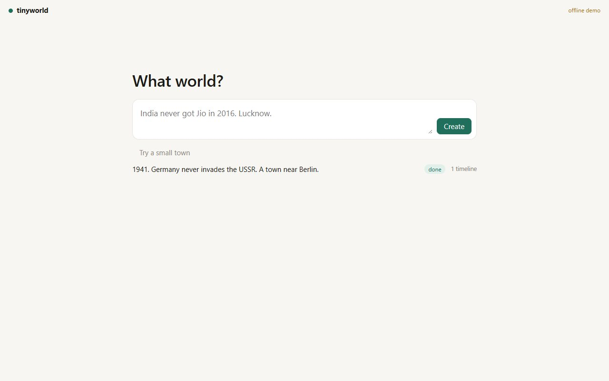
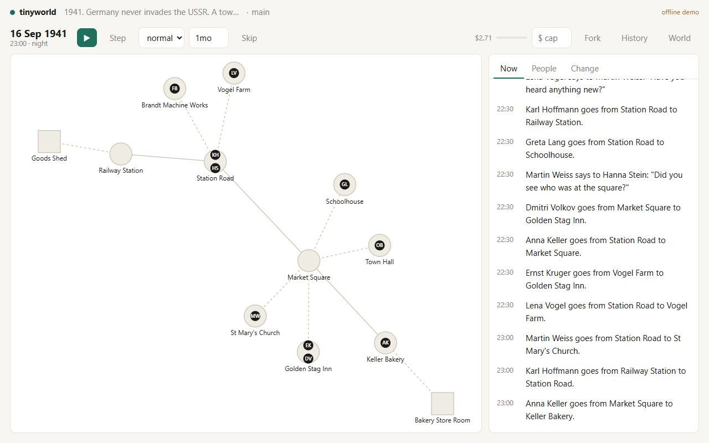
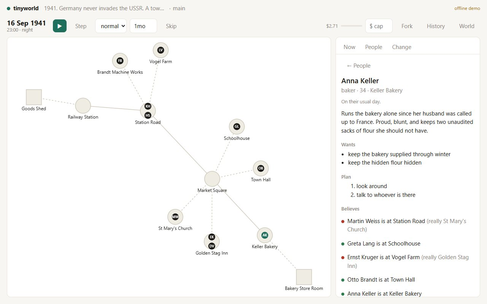
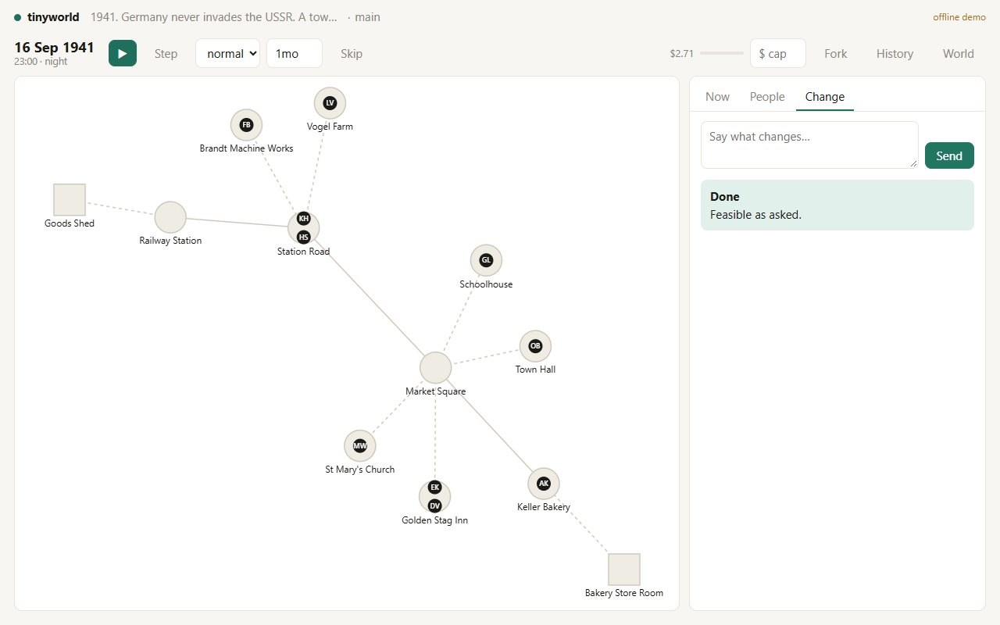
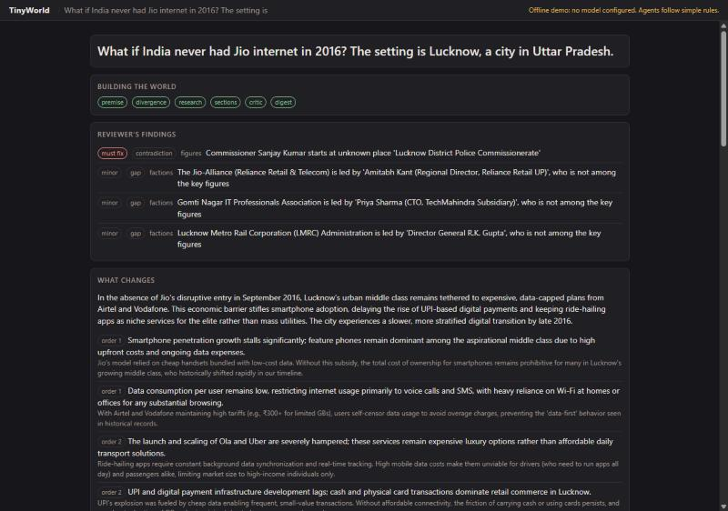
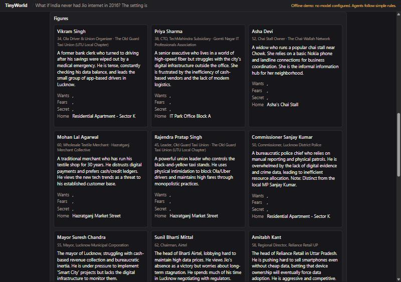
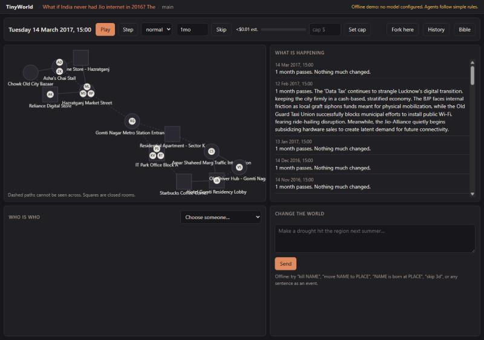
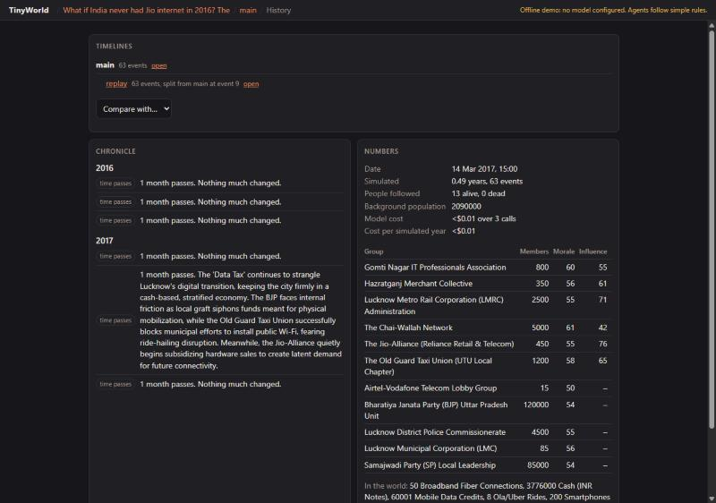

# TinyWorld

A world you describe in a sentence, researched and written up as a world bible,
then run by LLM agents who decide for themselves. You watch, intervene as a god,
skip years, and fork history to see what else could have happened.

> "1941. Germany never invades the USSR. A town near Berlin."

That premise becomes a town of a dozen named people with goals, fears and
secrets, a few thousand background inhabitants, institutions and factions,
scarce flour and sealed Soviet grain in the goods shed. Then it runs.

## What changed in v3

People now live a day instead of being asked what to do every hour.

- **Routines.** Anyone with a home and a workplace sleeps at night, gets ready in
  the morning, and works in the day, by rule, with no model call. Work is paid.
  Free hours, and anything important that happens, go back to the model.
- **Long quiet steps.** When everyone is on routine the clock jumps to the next
  boundary (the end of a shift, the morning) in one step, and the shift is
  paid for all of it.
- **Scenes.** A line said to someone is answered inside the same step, for up to
  four turns. Tone changes how they regard each other.
- **Promises.** A promise made in a scene becomes a commitment with a due time. It
  is kept or broken when it falls due, trust moves, and both people remember it.
- **A run report.** `python -m tinyworld.eval.report --db worlds.sqlite` shows what
  the agents did: the mix of actions, waiting and repetition, why attempts
  failed, calls per simulated day, promises kept and broken.
- **A quieter interface.** Describe a world, watch it on the map, open a person,
  change something. Routine lines are hidden from the feed until you ask.

<p>


</p>
<p>


</p>

These screenshots are the **offline demo**: the Berlin bible with scripted
agents, not a real model. They show the interface and the mechanics. They are not
evidence that a model produces interesting lives; that still has to be shown on a
live run (see [Results so far](#results-so-far)).

What the report said about that offline run (39 simulated hours, 10 people),
before and after two fixes:

| | before | after (four runs) |
|---|---|---|
| model calls per simulated day | about 1,140 | 460 to 530 |
| promises kept | 1 of 10 | 22 of 22 |
| waiting / repeating | 5% / 0% | 4% to 8% / 0% |

Two things changed. Ordinary routine lines ("X sleeps", "X works at …") are no
longer sent to a model to be scored, which was most of the memory upkeep. And a
promise to be somewhere is now part of the person's day: the routine walks them
there in time, and a step is cut short so someone is never skipped past the
moment they had to set out. These are scripted agents, so the 22 of 22 says the
mechanism works, not that a real model keeps promises.

- **Knowledge.** A small graph of ideas lives in the world rules. Everyone
  holds the common ones; others are held by few, or by nobody yet. A person
  can only come to know an idea if they already hold what it builds on.
- **Projects.** A person can start an undertaking of their own with the `start`
  verb. The rules check it: items must exist, helpers must be people, a large
  undertaking cannot be done alone, and working out a new idea needs its
  foundations. Skill sets how fast it goes. Finishing a discovery teaches the
  workers and records a fact that others can hear about.
- **Teaching.** In a conversation someone can teach an idea they hold well to a
  person who is ready for it.

Not done yet: people changing over a life, the year-by-year skip, factions
that decide things, news from outside the town. The plan is in
[docs/V3_PLAN.md](docs/V3_PLAN.md).

## Running it

```bash
pip install -e ".[llm,dev]"
python -m tinyworld.api.app
```

Open <http://127.0.0.1:8000>. Worlds are kept in `.tinyworld_data/worlds.sqlite`
(set `TINYWORLD_DB` to use another file).

**With a model.** Set `ANTHROPIC_API_KEY` before starting. Genesis then reads
your premise, researches it on Wikipedia, writes and reviews the bible, and the
agents, Game Master, god parser and chronicler all run on the model.

**Without a model** the server runs an offline demo: genesis returns a prepared
bible for the Berlin premise whatever you type, and agents follow simple rules.
Everything else — the map, god commands in a small fixed syntax, time skips,
forks, history — works the same. It is for trying the application, not for
judging how interesting a world is.

**With Gemini.** Set `GEMINI_API_KEY` instead (or `TINYWORLD_PROVIDER=gemini` if
both keys are set). Tiers map to `gemini-3.5-flash`, `gemini-2.5-flash` and
`gemini-3.5-flash-lite`; change them with `GEMINI_MODEL_STRONG`, `_STANDARD`,
`_CHEAP`. No Gemini prices are built in, so cost shows as $0 and a budget cap
will not trip until you add prices to the JSON file below.

**With OpenRouter.** Set `OPENROUTER_API_KEY` to use any hosted model. Choose
models per tier with `OPENROUTER_MODEL_STRONG`, `_STANDARD`, `_CHEAP`. Hidden
reasoning is off by default (`OPENROUTER_REASONING=on` enables it): it made
calls roughly six times slower and longer with no benefit for these bounded
tasks. Real per-call cost is taken from OpenRouter's usage report.

A rejected key, or no credit, stops the run with an error instead of letting
everyone quietly "wait".

Which model each role uses is set in one place, `tinyworld/llm/router.py`, and
can be overridden with a JSON file named by `TINYWORLD_LLM_CONFIG`.

### Checking that a model works with it

```bash
python -m tinyworld.llm.smoke --provider gemini
python -m tinyworld.llm.smoke --prompt "Any question you like"
python -m tinyworld.llm.smoke --only agent god
python -m tinyworld.llm.smoke --list-models
```

To run the whole application once on a premise and get a report on it
(genesis, seeding, steps, god commands, a time skip, invariants,
anachronisms, persona judging, and a replay with no model calls):

```bash
python -m tinyworld.eval.scenario --provider openrouter --ticks 2 --skip 6mo   --premise "What if India never had Jio internet in 2016? Lucknow, Uttar Pradesh."
```


It sends the application's real prompts (an agent deciding, the Game Master
adjudicating, a god command, genesis reading a premise), validates each reply
against the real schema, and reports pass or fail, repairs needed, tokens and
time. The key may also be put in a `.env` file in the project folder.

## What you can do

- **Genesis.** Enter a premise. Watch it pass through premise, divergence,
  research, sections, critic and digest. Read the bible, edit any section,
  see the reviewer's findings, then start a timeline.
- **World.** A map of places and people, a feed of what happens, an inspector
  for each person (character sheet, what they are thinking, their plan, what
  they believe and whether it is true, what they remember, what they cost),
  and a box for changing the world in plain words.
- **God commands** come back with a verdict and a reason: done, done with a
  change, not possible, unclear, or "that is in the past" with an offer to
  branch the timeline there.
- **Time.** Play, pause, step, or skip days to decades. Long skips are told by
  a chronicler period by period; everything it proposes is checked before it
  becomes history.
- **History.** The branch tree, a comparison of two timelines, the chronicle
  by year with a "why?" trace for each entry, numbers including cost per
  simulated year, an invariant check, and a replay check.

## How it works

The design is in [docs/IMPLEMENTATION_PLAN.md](docs/IMPLEMENTATION_PLAN.md).
In short:

- **State is a fold over an event log.** Nothing changes the world except an
  event committed through `WorldSession.commit`. Forking a branch copies
  nothing; it just reads its parent's log up to the fork point.
- **Models never write state.** Agents propose intents. The Game Master settles
  what it can with rules and asks a model about the rest; either way the
  result is a list of effects from a closed set of seventeen, applied by
  deterministic reducers.
- **Every model call is recorded.** A run is journaled (ticks, skips, god
  commands, budget changes) and can be replayed from the recording with no
  model calls, producing an identical event log.

```
tinyworld/
  core/      ids, time, state, effects, events, reducers, store, session, branches, causes
  llm/       client, router, structured calls, trace and replay, ledger, fake, offline, embeddings
  gm/        verbs, rules, adjudicator, conflicts, perception, master
  agents/    persona, memory, retrieval, beliefs, reflection, planner, agent
  genesis/   bible, research, critic, seeding, pipeline
  god/       parser, feasibility, compiler, channel
  sim/       loop, step, tiers, scheduler, budget, chronicler, timeskip, schedule, replay
  eval/      invariants, anachronism, judge, divergence, metrics
  api/       app, hub, runner, views, static/app
```

## Tests

```bash
python -m pytest -q
```

Set `TINYWORLD_DEBUG=1` to check every committed event against the invariants
as the tests run; CI does this.

## Results so far

One whole-application run on a premise unrelated to the built-in example:

> **"What if India never had Jio internet in 2016? The setting is Lucknow, a
> city in Uttar Pradesh."**

Run with OpenRouter, model `qwen/qwen3.7-flash` for every tier, hidden
reasoning off, research from Wikipedia. Command:

```bash
python -m tinyworld.eval.scenario --provider openrouter --ticks 2 --skip 6mo --judge 3   --premise "What if India never had Jio internet in 2016? The setting is Lucknow, a city in Uttar Pradesh."
```

### What worked

| Stage | Result |
|---|---|
| Premise | Placed in Lucknow, 15 September 2016; divergence recognised as "Jio does not launch" |
| Divergence | Three orders of consequence with confidences, e.g. smartphone growth stalls (90%), Ola/Uber stay luxury (80%), UPI lags and cash dominates (75%) |
| Research | 5 Wikipedia sources fetched and turned into cited notes |
| Bible | 12 places, 13 people, 6 factions, 5 institutions, 7 resources, 5 tensions |
| Review | 4 findings, 1 blocking, after capped redraft rounds; all shown, none hidden |
| Seeding | 13 people, 12 places, 16 links; one repair, which it reported |
| Invariants | Held over all 63 events |
| Replay | 54 of 54 events reproduced from the recording with **0** calls to the provider |
| Cost | Genesis: 28 calls, 277,524 tokens in / 49,530 out; 604 s wall time |



*The generated bible: what changes, and what the reviewer flagged.*



*The people it wrote. Note the empty "Wants / Fears / Secret" lines: see below.*



*The seeded city after a six-month skip: places as a graph, people on them, a
feed of what happened.*



*Chronicle by year, group morale and influence, and the resources in the world.*

### What did not work, and why

This run is **not** a demonstration that the agents behave well on a real
model. Read the following before the screenshots above.

- **The simulation part was not exercised live.** The OpenRouter key expired
  part-way through (HTTP 401). Every call after genesis failed, and at the time
  a failed call silently became "wait". Result: every person waited in both
  steps, both god commands came back "needs clarifying", and persona judging
  produced nothing. Those lines in the run's report are not evidence about the
  model.
- **The people had no goals.** The model returned empty strings for every
  person's goals, fears and secrets, and nothing noticed. That is visible in
  the figures screenshot. Even with a working key those agents would have had
  nothing to want.
- **The chronicler's proposals were mostly thrown away.** Of six periods only
  one produced an entry (the "Data Tax" paragraph in the history screenshot).
  Five proposed events were ruled out because the model named people as
  `karan_verma` rather than `person:karan_verma`.
- **Real people appeared.** The bible includes real, named individuals
  (executives, a police commissioner) as characters, which is a questionable
  thing for a simulation to invent speech and secrets for. Nothing in the
  premise asked for this, and nothing stops it yet.
- **Faction leaders were not among the people.** The review reported three
  factions led by someone who is not one of the key figures, and one person
  starting at a place that does not exist (repaired during seeding).

### Fixed afterwards

Each of these was found by this run and now has a test:

- A rejected key or missing credit raises an error instead of becoming "wait".
- Blank list entries are dropped, and a person with no goals is a blocking
  review finding that triggers a redraft.
- The chronicler's names and bare slugs are resolved to ids, as agents' are.
- "Undefined resource" findings are sent to the section that can fix them.
- A world made from the built-in example says so; other worlds no longer carry
  that banner.

### Checked separately, on real models

Short runs of the real prompts, one model call per step
(`python -m tinyworld.llm.smoke`), each validated against the real schema:

| Model | prompt | agents (3 people) | Game Master | god command | premise parse |
|---|---|---|---|---|---|
| `google/gemini-3.5-flash-lite` via OpenRouter | pass | pass, 0 repairs | pass | pass | pass |
| `qwen/qwen3.7-flash` via OpenRouter | pass | pass, 13 s | pass | pass | pass (run with reasoning on) |
| `gemini-2.5-flash` (Gemini API) | pass | 2 of 3 people fell back | pass | pass | pass |

The Gemini fallbacks were the same missing-prefix bug as above, fixed since.
Turning reasoning off on `qwen/qwen3.7-flash` took the agent step from 75 s and
4,392 output tokens to 13 s and 593.

### Still to show

A complete run on a real model with a working key: agents acting from goals,
a god command, a skip with chronicled events, persona judging, and a measured
spread across several runs of the same premise. Rerun the command above to
produce that report.

## Limits worth knowing

- The agent, Game Master, chronicler and genesis prompts have been exercised
  against scripted and rule-driven stand-ins, not judged against a real model
  in long runs. How lively, consistent and period-true the worlds are with a
  real model has not been measured yet; `POST /api/branches/{id}/judge` and the
  divergence tools exist for that.
- Research uses Wikipedia's public API. Search results are untested against
  the live service.
- The map is a relaxed graph drawn on a canvas, not tiles or sprites.

The previous, rule-based version (`WORLD/`) was removed after its useful ideas
were carried over; see [docs/V1_CONCEPTS.md](docs/V1_CONCEPTS.md). It remains
in the git history.
