# TinyWorld

Describe a world in a sentence. TinyWorld researches it, writes it up as a world
bible, and runs it with autonomous agents. You watch, intervene as a god, skip
years, and fork history to see what else could have happened.

> "What if India never had Jio internet in 2016? Lucknow, Uttar Pradesh."

That becomes a city of a dozen named people with goals, fears and secrets,
institutions and factions, scarce things and live tensions. Then it runs.

<p>
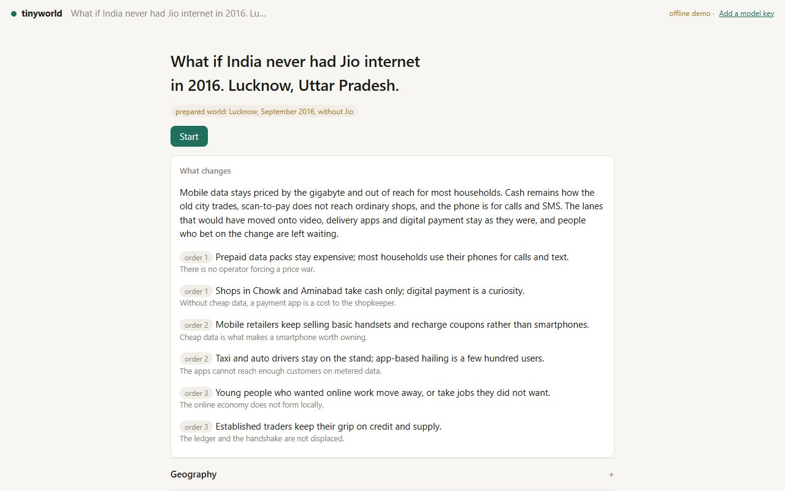
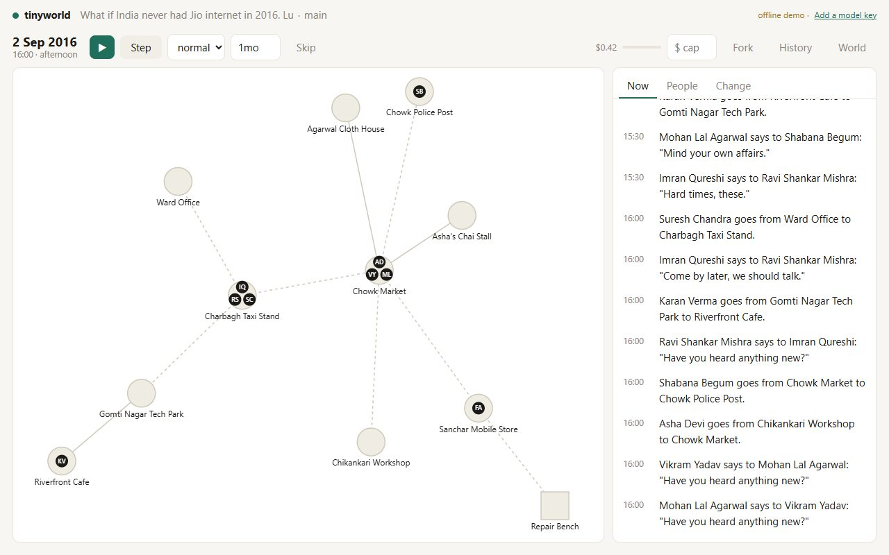
</p>
<p>


</p>

Contents: [How well it works](#how-well-it-works) · [What you can do](#what-you-can-do-with-it) · [System design](#system-design) · [Roadmap](#roadmap) · [Running it](#running-it)

## v7: the living town

The world is a place you can see, and the people in it live on their own clocks. They walk real
paths between buildings, see each other across a street and start talking, walk to the edge of the
known ground and make the map grow, come to a shrine to ask you for something, marry, have children,
grow old and leave their goods to an heir. A paper comes out each day. You can follow anyone, ask them
what they remember, run the same world twenty times and see what changes, and share it with a
demigod and a god with a goal of their own.

<p>
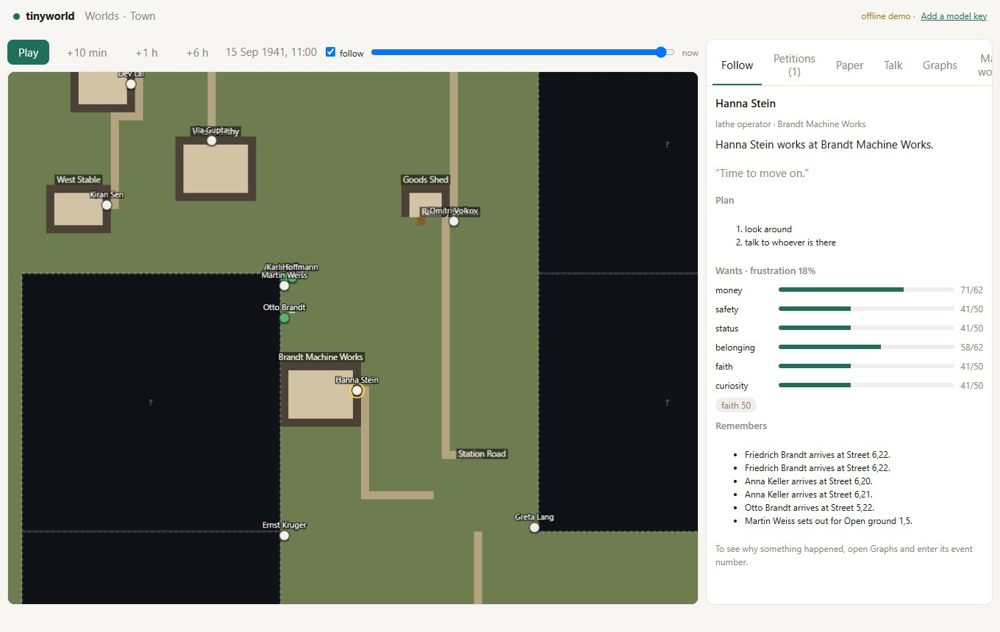
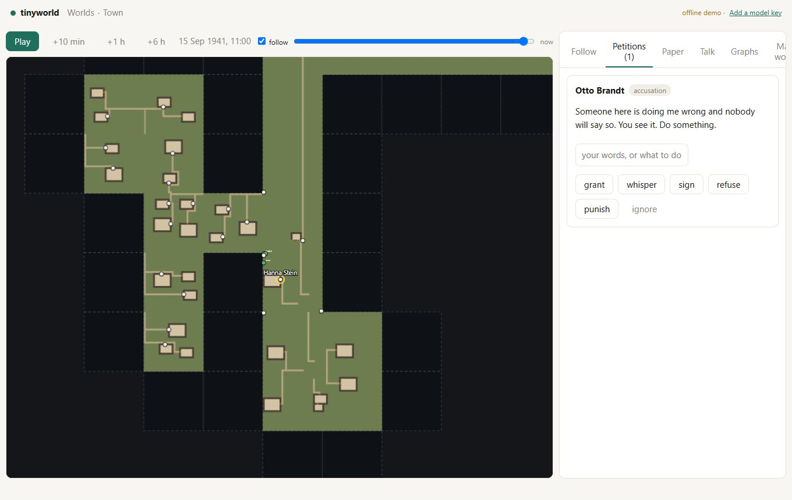
</p>

Behaviour is stochastic; storage is a recording. Chance comes from the operating system and every
draw is written down, so two live runs differ and a replay of either is identical to it. What each
phase does, what it was checked against and what is not done (Postgres; human labels for the judges;
a long live run on a hosted model) is in [docs/V7_STATUS.md](docs/V7_STATUS.md), against
[the plan](docs/V7_PLAN.md). Open any world's **Town view** from its page.

## v6: the studio

You do not just watch a world any more. You give a goal, and a **team of agents
builds the world while you watch**, asks you when a decision is yours, and lands
nothing until you press **Merge**. Then the residents live in it.

<p>
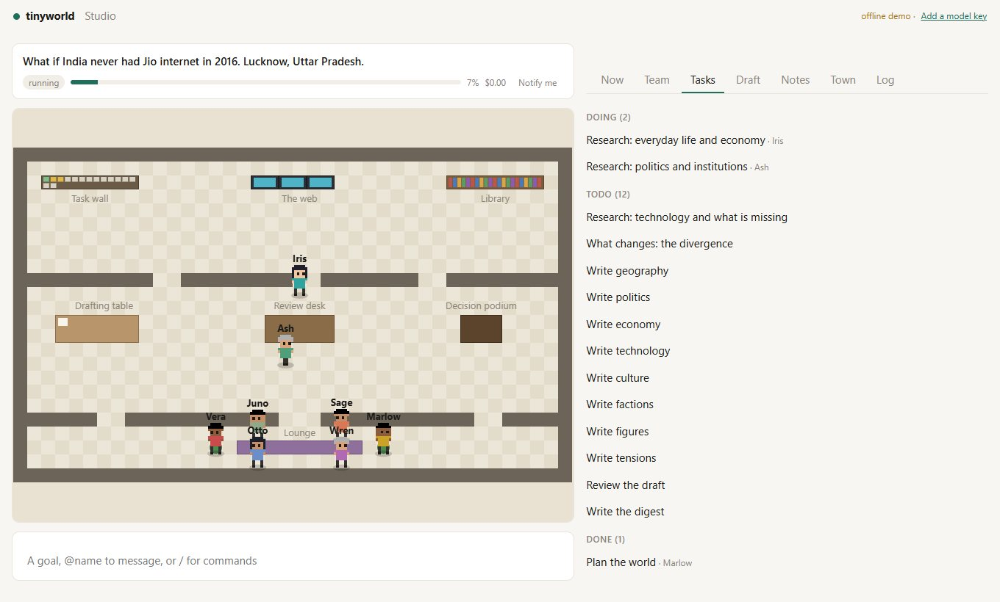
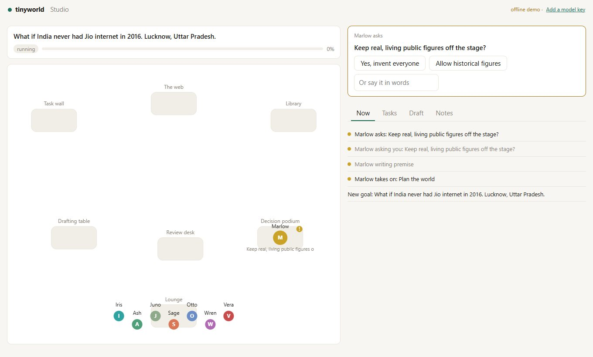
</p>
<p>
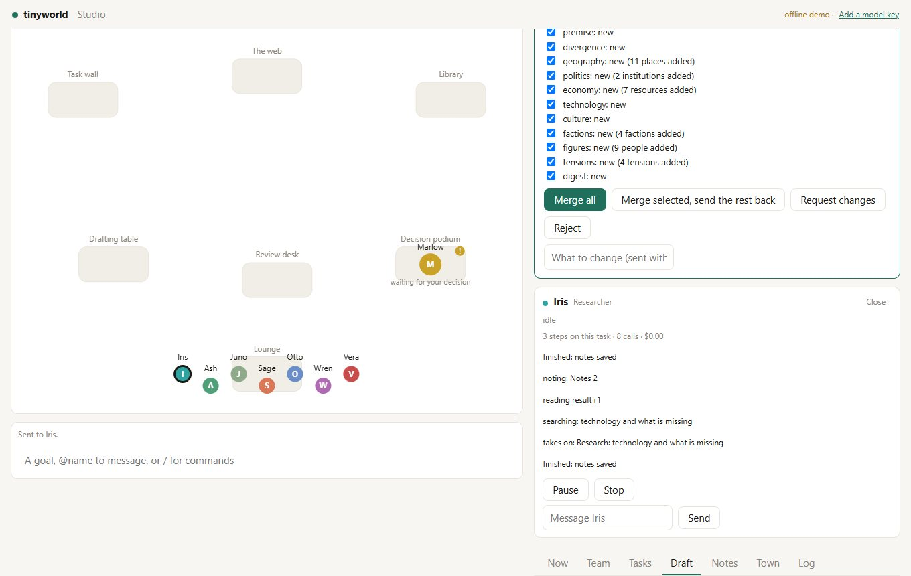
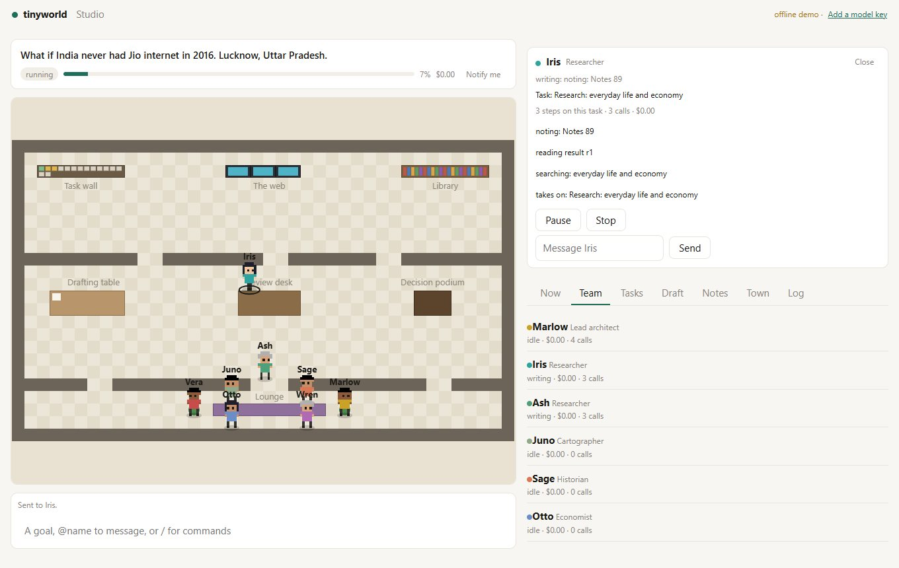
</p>
<p>
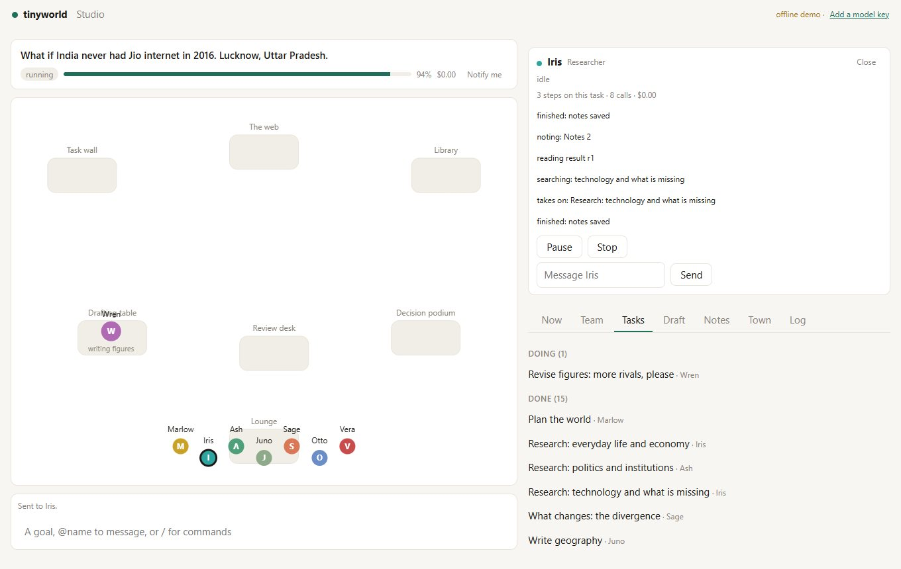
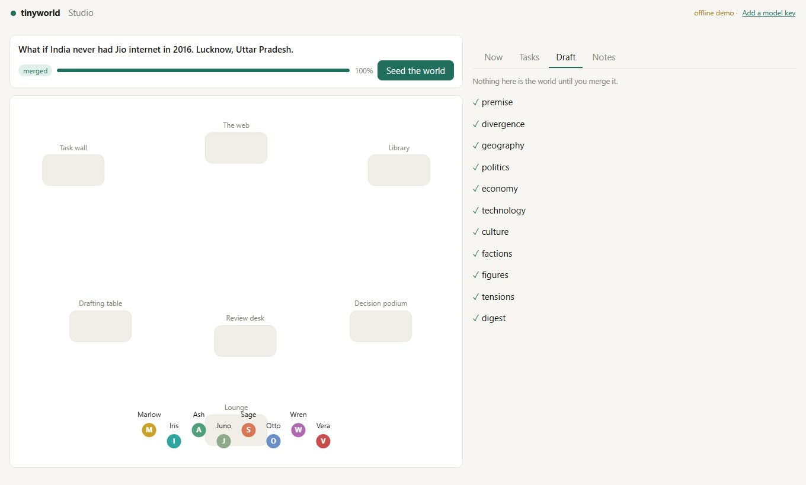
</p>

A real build, on Qwen 2.5 7B running locally (Lucknow, 1857):

<p>
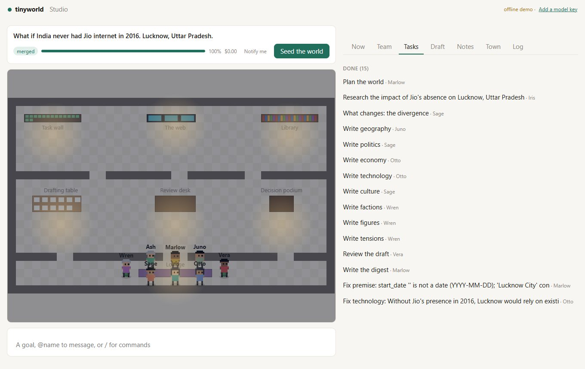
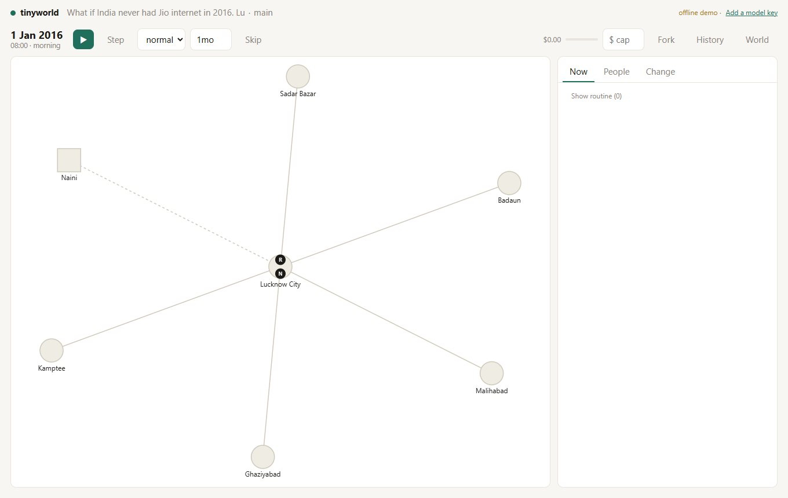
</p>

- **A cast, each with a job.** Marlow leads and plans. Iris and Ash research.
  Juno draws the map, Sage writes history and politics, Otto the economy and
  technology, Wren the people and factions. Vera reviews and sends sections
  back.
- **Real tools.** They search the web, read pages, keep shared notes, write
  sections that are checked against the real schema, and ask you questions.
  What an agent is doing is read from the tools it uses, not from what it says.
- **A task graph.** Figures wait for the geography and factions; tensions wait
  for figures. Up to three tasks run at once.
- **You are in the loop.** Questions and the final merge arrive at a podium.
  Request changes, with your note, puts the team back to work. Reject changes
  nothing.
- **Closing the page loses nothing.** The foreman keeps the state; the page is
  only a window. A build that was running when the server stopped carries on.
- **Merge part of it.** The merge card shows what would change in words ("9
  people added"), with a checkbox per section. Merge what you like and send the
  rest back with a note. If the live world changed while the team worked, the
  merge is refused and the team rebases first.
- **A console.** `@juno make the old city denser` reaches Juno at her next step,
  even mid-task. `/status`, `/pause @x`, `/stop @x`, `/budget 5`, `/answer`.
  Click an agent for its card: state, task, recent log, cost, pause, stop, message.
- **Spend and permission under control.** Each agent shows what it has cost. A
  goal can have a budget; at the limit the team stops and asks. Reading a page
  from a new site asks first, and says what "Always allow" covers. Everything
  the team does outside the draft is in an audit log.
- **A draft that names real, living people** cannot be merged with one click: it
  needs an explicit "Merge anyway", which is logged.
- **Replay.** Model replies, searches, pages and your answers are recorded, so a
  build replays with no model, no web and nobody to ask, and gives the same draft.
- **Measure it.** `python -m tinyworld.eval.studio_bench` reports first-pass
  rate, rework, blocked tasks, questions asked, cost and time per build.
- **Works with no model.** Without a key a scripted team plays the same roles
  with the same protocol, so the whole studio runs and can be demoed.

```bash
python -m tinyworld.api.app          # then "Build with the team" on the home page
```

- **A studio you can watch.** A tiled floor with rooms and doorways; pixel
  characters, each with its own look, walking real paths between stations; a
  card per task on the wall and a paper per written section on the drafting
  table; a lit podium when you are needed; day and night from your clock.
- **Tried before it is merged.** The draft is seeded in a scratch store and run
  for a while; the merge card shows how many steps ran, who acted, and any
  invariant problem. The draft itself is a real bible version that the world
  does not point at until you merge.
- **Residents who look before they act.** A resident who deliberates can look
  around, recall memories, check promises and projects, then decide, with the
  same rules checking the decision.

**Honest status.** All of this is tested with the scripted team, and the studio
has now had **two short live probes on an open-weight model** (Nemotron 3 Super
120B through OpenRouter's free tier, with live web search). They found real
problems: a researcher that never stopped searching, and a section reply cut off
mid-JSON. Both are fixed and the fixes are tested, but the free daily quota ran
out before a full build could be run live, so **a complete live build has still
not happened** on a hosted model (it has on a local one, below). A durable job queue and worker processes are built (`python -m tinyworld.studio.worker`); Postgres is not. Details, step by step, are in
[docs/V6_PLAN.md](docs/V6_PLAN.md#the-first-live-runs). The design follows
[AgentCraft](https://github.com/blendi-remade/agentcraft): a foreman that owns
the truth, a view that holds none, agents that use tools, a decision queue, and
a human merge gate. It differs in building worlds that then run, in recording
every call so a run replays, in working with any model, and in being a web page.

## How well it works

Read this first. It says what has been seen working on a real model, what has
only been shown on scripted stand-ins, and what is not built.

| Part | Status | Evidence |
|---|---|---|
| The studio: a team of tool-using agents builds the world, you merge it | **Built (v6.0)**, scripted team and scripted-model tests, checked in a browser | **Not run with a real model.** The tool loop, task graph, decision queue, draft and merge gate are tested end to end. |
| Premise to world bible | **Works live**, slow | Lucknow 2016 on OpenRouter: 12 places, 13 people, 6 factions, 28 model calls, about 10 minutes. Gandhi premise: premise, divergence and 7 sources worked; stopped at drafting when the account ran out of credit. |
| Seeding and the event log | **Works** | Invariants held over every run; a recorded run replays to an identical log with **0** model calls (54 of 54 events). |
| Agents deciding, Game Master, god command | **Passes smoke tests live**, not seen in a long live run | One real call per step validated against the real schema on three models. A complete live run was cut short by an expired key. |
| Days that run on routine | **Works with scripted agents** | Offline Berlin demo, 39 simulated hours, 10 people: model calls per simulated day 1,140 down to 460 to 530. |
| Conversations and promises | **Works with scripted agents** | 22 of 22 promises kept over four offline runs (1 of 10 before the fix). This shows the mechanism, not that a model keeps promises. |
| Knowledge and projects | **Works, covered by tests**, never seen live | A person can start a project, a discovery needs its foundations, finishing teaches the workers. |
| Open-weight models (any OpenAI-compatible server: vLLM, Ollama, llama.cpp) | **Runs live: three full studio builds** | Qwen2.5-7B-Instruct Q4 on llama.cpp, a 4 GB laptop GPU: Lucknow, Gandhi's India and a Mars colony each went from plan to merge with no person, 112 to 140 calls and about 50 minutes each. Details in [docs/V6_PLAN.md](docs/V6_PLAN.md#three-full-builds-on-a-local-open-weight-model). Not yet run on vLLM or Ollama. |
| Research agent with web search | **Built (v4)**, web search works live | DuckDuckGo returned results and page text with no key. The read, find gaps, search again loop is tested with a scripted model, not yet run live end to end. |
| Genesis in parallel waves | **Built (v4)**, measured on a simulated delay | 13 calls either way; with 0.25 s per call, 3.40 s sequential against 2.09 s in waves. Not timed on a real model. |
| Real people in a bible | **Guarded by the reviewer (v4)**, not seen live | The reviewer prompt and the figures brief now forbid living public figures, and a `real_person` finding blocks and triggers a redraft. Tested with a scripted reviewer. |
| Persona change, year-by-year skips, factions that decide, outside news | **Not built** | Planned in [docs/V3_PLAN.md](docs/V3_PLAN.md). |

The honest summary: **building a world from a sentence works on a real model.
Living in it has been verified in pieces, not as one long live run.** Run the
command under [Checking that a model works with it](#checking-that-a-model-works-with-it)
with a funded key to produce that run yourself.

## What you can do with it

Each example says what to type, what you get, and how far it goes.

### 1. "What if India never had Jio internet in 2016? Lucknow."

A counterfactual with a clear place and date.

- **You get:** a bible with three orders of consequence (smartphone growth
  stalls, ride-hailing stays a luxury, UPI lags and cash dominates), research
  from Wikipedia with cited notes, 12 places, 13 people, factions and tensions.
- **Seen live:** all of it, in one run. 28 calls, 277,524 tokens in and 49,530
  out.
- **Extent:** the people came back with empty goals in that run, and some were
  real executives. Both are fixed or flagged since (blank goals now trigger a
  redraft); neither has been re-checked on a live run.

### 2. "1941. Germany never invades the USSR. A town near Berlin."

The built-in reference world: Soviet grain in the goods shed, a baker hiding
flour, a mayor falsifying ration cards.

- **You get:** ten people with conflicting aims, ration scarcity, a party
  informer, a Soviet inspector at the inn.
- **Seen:** offline with scripted agents (this is the prepared world), and in
  tests for genesis. Not judged against a model for how lively it is.
- **Extent:** with no key the page picks this world for any premise that fits
  neither prepared world, and says it was not built from your text.

### 3. "What happens if Gandhi died before independence, will India still get it?"

A question about history, not a setting, with a real, famous person.

- **You get, live:** the premise read, a divergence with consequences, and 7
  research sources. That part ran.
- **Not seen:** the bible. The account had no credit, so section drafting
  stopped at technology.
- **Extent:** a vague question works as a premise on a model that can read it.
  The first attempt failed because one model refuses to run without reasoning,
  and the app reported that as "could not read the premise"; both are fixed.
  Gandhi himself would appear as a character, and there is no guard for that
  yet. Prefer a place and a date: "a district town in Uttar Pradesh, 1946".

### 4. Change the world in a sentence

Type into the Change tab. With a model, any wording; offline, a small fixed
syntax:

| Say | Result |
|---|---|
| `Albert Einstein is born at the bakery` | A newborn with a generated persona, who ages and is promoted to an acting person when old enough |
| `kill Otto Brandt` | The mayor dies; witnesses remember it |
| `move Lena Vogel to Town Hall` | Moved, if there is a way there |
| `skip 6 months` | The chronicler narrates the period; each proposed event is checked before it counts |
| a request that is impossible, unclear, or in the past | A verdict with a reason, or an offer to branch the timeline at that point |

- **Extent:** the god channel is tested end to end and replays exactly. Free
  wording on a real model passed its smoke test; it has not been run at length.

### 5. Fork history and compare

Fork at any moment, make a different change on each branch, skip both forward,
then open the comparison.

- **You get:** the branch tree, a diff of people, things and facts, and a
  chronicle by year with a "why" trace for each entry.
- **Extent:** branches share their parent's log, so a fork is free. The
  comparison is real for scripted runs; how different two model-driven worlds
  become has not been measured.

### 6. Watch ideas and projects (new in v3)

People can start undertakings of their own, and new ideas need foundations.

- **Example from the tests:** a radio transmitter needs radio repair and
  electrical wiring. Nobody can start it without them; a team that has them
  works for months (harder ideas take longer); when it is done the workers know it, and a fact "X worked
  out radio transmitters" is recorded. A rocket motor then becomes possible
  because the transmitter now exists.
- **Extent:** a small graph of ideas (tens of nodes) per world, built from the
  bible's technology section. It limits what can happen; it does not invent
  physics. Not yet seen driven by a real model.

## What changed in v3

People now live a day instead of being asked what to do every hour.

- **Routines.** Anyone with a home and a workplace sleeps at night, gets ready in
  the morning, and works in the day, by rule, with no model call. Work is paid.
  Free hours, and anything important that happens, go back to the model.
- **Long quiet steps.** When everyone is on routine the clock jumps to the next
  boundary in one step, and the shift is paid for all of it.
- **Scenes.** A line said to someone is answered inside the same step, for up to
  four turns. Tone changes how they regard each other.
- **Promises.** A promise made in a scene becomes a commitment with a due time. It
  is part of the person's day: they set out in time. It is kept or broken when
  it falls due, trust moves, and both people remember it.
- **Knowledge, projects, teaching.** See example 6.
- **A run report.** `python -m tinyworld.eval.report --db worlds.sqlite` shows the
  mix of actions, waiting and repetition, why attempts failed, calls per
  simulated day, promises kept and broken.
- **A quieter interface,** a prepared world that fits your words when there is no
  key, and a place to add a key from the page.

Offline Berlin demo, 39 simulated hours, 10 people, before and after:

| | before | after (four runs) |
|---|---|---|
| model calls per simulated day | about 1,140 | 460 to 530 |
| promises kept | 1 of 10 | 22 of 22 |
| waiting / repeating | 5% / 0% | 4% to 8% / 0% |

Ordinary routine lines ("X sleeps") are no longer sent to a model to be scored,
which was most of the memory upkeep. These runs use scripted agents.

## To what extent

| Question | Today |
|---|---|
| How many people? | About 8 to 15 followed closely; thousands more as a background number. Not tested at 100. |
| How long does a world take to build? | About 10 minutes on a hosted fast model. Slow, and it is the longest wait. |
| What does a simulated day cost? | Offline: 460 to 530 model calls per day for 10 people. On a model that is real money; the app shows cost and has a budget cap. Gemini prices are not built in. |
| How long can it run? | Time skips of days to decades, narrated by a chronicler. A year-by-year simulated skip is not built. |
| Is it accurate history? | No. It is a plausible reading, researched from Wikipedia, checked for anachronisms by keyword. Treat it as fiction with a research base. |
| Is it repeatable? | Yes for a recorded run: replay gives an identical event log with no model calls. A new run on a model differs. |
| Does it need a key? | No for the offline demo; yes to build a world from your own words. |

## System design

One process, one asyncio loop, one SQLite file. The event log is the only
source of truth; everything else is derived from it.

```
 Browser (plain JS: home, genesis, world map, history)      REST + WebSocket
        |
 FastAPI app ---- Hub: store, model client, genesis jobs, one BranchRunner per branch
        |
 BranchRunner (play / pause / step / skip, holds a lock so one tick runs at a time)
        |
 Simulation.tick()  ----------------------------------------------------------
   1 clock moves; queued god events fire; promises due are settled
   2 DECIDE   every due agent, in parallel, from the same snapshot
                 routine (no call) | react (short call) | deliberate (full call)
   3 RESOLVE  Game Master: rules first, adjudicator for the rest
   4 SCENES   a line to someone is answered, one scene at a time
   5 REMEMBER witnesses score and store what they perceived (parallel)
   6 REFLECT  agents whose memories crossed a threshold reflect (parallel)
 ---------------------------------------------------------------------------
        |
 WorldSession.commit  ->  reducers (closed set of effects)  ->  event log (SQLite)
        |                                                            |
 StructuredLLM: schema, repair, trace, budget, replay        snapshots, memories,
        |                                                    beliefs, journal, bible
 Anthropic | OpenRouter | Gemini | offline stand-in
```

**Rules that make it reproducible**

- Models propose, reducers decide. No model output writes state.
- Every model call is recorded; a run replays from the recording with no calls.
- Order inside a tick is canonical (agents by id, intents shuffled by a seed
  derived from the branch and tick), so a replay is identical.

### Who runs at the same time, and who does not

Agents do not message each other. They interact only through the world: one
acts, an event is committed, others perceive it (by sight, hearing, or word of
mouth) and remember it. The Game Master sits between every pair.

| Work | Concurrency | Bound |
|---|---|---|
| Ticks of one branch | **Sequential.** One at a time, in order. | One lock per branch |
| Agents deciding in a tick | **Parallel.** Every due agent decides at once from the same snapshot, then all wait for the slowest (a barrier). | Provider limit: OpenRouter 6 in flight, Gemini 4, Anthropic by the SDK |
| Agents on routine | **No call.** They carry out their day by rule and can jump hours at once. | none |
| Tier-1 agents | **Staggered.** Each acts every 4th tick, offset by a hash of its id, on the cheap model. | `tier1_every` |
| Tier-2 background | **No individual.** Morale and influence drift by rule once a day. | none |
| Simple intents (move, speak, give, wait, rest, work) | **Sequential**, in a seeded shuffle, so two people reaching for the last loaf are settled without a model. | deterministic |
| Contested intents | **Parallel by group.** One adjudication per group of agents competing for the same thing. | one call per group |
| Conversation scenes | **Sequential.** Two people, up to 4 turns, at most 6 scenes a tick: at most 12 people talking in one tick. | `max_scenes`, `max_turns` |
| Memory scoring | **Parallel per witness.** A witness keeps at most 8 observations a tick; routine ones cost no call. | `attention_limit` |
| Reflection, compaction | **Parallel** for whoever is due. | threshold |
| Branches | **Independent.** Each has its own runner; they share a process, not state. | one process |
| Research | **Parallel (v4).** Every query is searched at once, then every new page is read and noted at once, then the research agent reviews its notes and may search again (up to 3 rounds). | 6 at a time |
| Genesis sections | **Parallel in waves (v4).** Geography, politics, economy, technology, culture and factions together; then figures (they need places and factions); then tensions (they are between figures). | 3 waves instead of 8 steps |
| Genesis stages | **Sequential**: premise, divergence, queries, research, sections, review, digest. | each needs the last |
| Time skips | **Sequential** per period. | planned: per agent per year |

So the honest answer to "how many agents are connected": any number can be due
in a tick, all of them decide in parallel against one frozen snapshot, and the
Game Master serialises what they do. The coupling is the shared world, not a
message bus. The largest worlds run so far hold 10 to 13 named people; a world
of 100 has not been run, and the per-tick call count grows with the number of
people who are not on routine.

What this model cannot do: an agent never reacts mid-tick to what another did in
the same tick (that happens next tick, or inside a scene), and nothing runs
across machines.

## Roadmap

Versions are stages of capability, not dates. Each lists what ends it.

### v3 (this branch): people live a day

Routines, scenes, promises, knowledge and projects, a quiet interface, prepared
worlds. **Ends when** one complete run on a real model, with a funded key, shows
agents acting from goals, a god change, a chronicled skip and judged
personas. Not yet shown.

### v4: open-weight models, and a cheaper, faster platform

The aim is to run the whole thing on models you can host yourself, with every
system role an agent that can use tools.

| Item | State |
|---|---|
| Client for any OpenAI-compatible server, with adaptive concurrency | **Built**, tested against a simulated server |
| Tier config for open-weight models (`LOCAL_MODEL_*`), key-less connect from the page | **Built** |
| Research agent: parallel search, read, find gaps, search again | **Built**, scripted-model tests |
| Web search and page fetch, with a public-address guard | **Built**, search checked live |
| Genesis sections in dependency waves | **Built**, measured on a simulated delay |
| Real-person guard in the reviewer | **Built**, scripted-reviewer tests |
| Export of recorded calls as fine-tuning data (`python -m tinyworld.eval.distill`) | **Built**, unfiltered: judge a sample before training |
| Run a world end to end on an open-weight model | **Not done.** No local model server was available to test against. |
| Fine-tune and serve a small model for routine calls, and check it against the judge | Not done |
| Constrained decoding (grammar) for weak models | Partly: the schema is sent as `json_schema`, then `guided_json`, then `json_object` |
| Parallel time skips (one call per person per year) | Not done |
| Job queue and worker processes (lease, crash recovery, fair sharing between tenants, cap on running builds) | **Built, tested with the scripted team** |
| Postgres, sign-in | Not done. The queue is plain SQL on the same SQLite store, so the move is a driver change. |
| A live benchmark across premises and seeds | Not done |

**Ends when:** a world is built and run end to end on open-weight models only,
at least 5 times cheaper per simulated day than the hosted baseline, with
judged quality inside the set margin. Not met.

### v5: diversity

Today every person is played by the same model, so they share its habits:
agreeable, fluent, similar in how they talk. v5 is about making a world
actually varied.

- **Model diversity.** Different people run on different model families and
  fine-tunes, with their own sampling settings, so they disagree for different
  reasons. Measured, not assumed.
- **Cultural and linguistic diversity.** People speak and think in their own
  language and register (Hindi, Urdu and Awadhi in Lucknow; dialect in a German
  town), with culture-specific norms in their prompts and mixed-language
  speech where it is realistic. The interface is translated.
- **Population diversity.** Background populations built from distributions
  (age, caste, class, religion, occupation, income) per district, with notable
  people promoted out of the crowd when events touch them.
- **World diversity.** A library of eras, regions and genres, so a premise
  starts from a researched template instead of one generic shape.
- **Behavioural diversity metrics.** Vocabulary spread, opinion spread,
  disagreement and refusal rates, and divergence between seeds, reported next to
  cost.
- **Shared worlds.** More than one person steering the same world, with roles.

**Ends when:** the diversity metrics beat the v4 baseline by a stated margin on
the same premises, and a premise in a non-English setting is run in its own
language with a human reader judging it natural.

Both are plans. None of v4 or v5 is built; the detail behind them is in
[docs/V3_PLAN.md](docs/V3_PLAN.md).

## Running it

```bash
pip install -e ".[llm,dev]"
python -m tinyworld.api.app
```

Open <http://127.0.0.1:8000>. Worlds are kept in `.tinyworld_data/worlds.sqlite`
(set `TINYWORLD_DB` to use another file).

**With a model.** Set one key before starting: `ANTHROPIC_API_KEY`,
`OPENROUTER_API_KEY` or `GEMINI_API_KEY` (`TINYWORLD_PROVIDER` chooses if more
than one is set). Genesis then reads your premise, researches it on Wikipedia,
writes and reviews the bible, and the agents, Game Master, god parser and
chronicler run on the model.

**Without a model** the server runs an offline demo. Genesis picks the prepared
world that fits your words (Lucknow if you mention Lucknow, Jio or India;
Berlin for German or Soviet premises) and says which one it used. A premise that
fits neither gets the Berlin world, and the page says it was not built from your
text. Agents follow simple rules, so this is for trying the application, not for
judging how interesting a world is.

**Adding a key from the page.** The top right shows "Add a model key" when no
model is configured. Pick a provider and paste the key. It is checked with one
small call, then held in the server's memory only: not written to a file, the
database or the log, and gone when the server stops.

**Open-weight models (v4).** Any server that speaks the OpenAI chat-completions
protocol works: Ollama, vLLM, llama.cpp's server, LM Studio, TGI. Point the app
at it and name a model for each tier:

```bash
# Ollama
ollama pull qwen2.5:14b-instruct
export LOCAL_BASE_URL=http://localhost:11434/v1
export LOCAL_MODEL_STRONG=qwen2.5:14b-instruct LOCAL_MODEL_STANDARD=qwen2.5:14b-instruct LOCAL_MODEL_CHEAP=qwen2.5:7b-instruct
python -m tinyworld.api.app

# vLLM
vllm serve Qwen/Qwen2.5-14B-Instruct --port 8000
export LOCAL_BASE_URL=http://localhost:8000/v1 LOCAL_MODEL_STANDARD=Qwen/Qwen2.5-14B-Instruct

# llama.cpp on a small GPU: what the studio was tested with (RTX 3050, 4 GB)
llama-server -m Qwen2.5-7B-Instruct-Q4_K_M.gguf -ngl 16 -c 12288 -np 1 \
  --cache-type-k q8_0 --cache-type-v q8_0 -fa on --jinja --port 8081
export LOCAL_BASE_URL=http://127.0.0.1:8081/v1 LOCAL_CONCURRENCY=1 LOCAL_MAX_CONCURRENCY=1
python -m tinyworld.eval.studio_bench --provider local --probe   # one research task and one section
python -m tinyworld.eval.studio_bench --provider local --db build.sqlite   # a whole build
```

On a 4 GB card, keep the context small and quantise the KV cache: with the
default cache the model spilled out of VRAM and ran at 1.2 tokens per second;
with the settings above it ran at about 7. One request at a time
(`LOCAL_CONCURRENCY=1`) fits a single slot. A whole build on a 7B model takes
on the order of an hour this way.

`TINYWORLD_PROVIDER=local` forces it. `LOCAL_API_KEY` is optional. The page's
"Add a model key" box also takes a server address. Concurrency starts at
`LOCAL_CONCURRENCY` (default 4) and adapts: it grows after a run of successes
and halves when the server answers 429 or times out, up to
`LOCAL_MAX_CONCURRENCY` (default 32). Reasoning models' `<think>` blocks are
stripped. A model the server does not have stops the run with its name in the
error. Costs read as $0 unless you give prices in the config file.

**OpenRouter.** Choose models per tier with `OPENROUTER_MODEL_STRONG`,
`_STANDARD`, `_CHEAP`. Hidden reasoning is off by default
(`OPENROUTER_REASONING=on` enables it); it made calls about six times slower
with no benefit here. A model that refuses to run without it is detected and
asked again with low reasoning. Real per-call cost comes from OpenRouter's usage
report. An account with no credit stops the run with a clear error, and `:free`
models are often rate limited upstream.

**Gemini.** Tiers map to `gemini-3.5-flash`, `gemini-2.5-flash` and
`gemini-3.5-flash-lite`; change them with `GEMINI_MODEL_STRONG`, `_STANDARD`,
`_CHEAP`. No Gemini prices are built in, so cost shows as $0 and a budget cap
will not trip until you add prices to the JSON file named by
`TINYWORLD_LLM_CONFIG`.

**Web search.** With a model, research uses Wikipedia and DuckDuckGo together
(no key). Set `TINYWORLD_WEB_SEARCH=off` for Wikipedia only. Fetched pages are
limited to public http and https addresses, reduced to plain text, and only
ever shown to the model as quoted material to take notes from.

A rejected key, or no credit, stops the run with an error instead of letting
everyone quietly "wait". Which model each role uses is set in
`tinyworld/llm/router.py`.

### Checking that a model works with it

```bash
python -m tinyworld.llm.smoke --provider openrouter
python -m tinyworld.llm.smoke --prompt "Any question you like"
python -m tinyworld.llm.smoke --only agent god
python -m tinyworld.llm.smoke --list-models
```

It sends the application's real prompts (an agent deciding, the Game Master
adjudicating, a god command, genesis reading a premise), validates each reply
against the real schema, and reports pass or fail, repairs needed, tokens and
time. To run the whole application once on a premise and get a report on it
(genesis, seeding, steps, god commands, a time skip, invariants, anachronisms,
persona judging, and a replay with no model calls):

```bash
python -m tinyworld.eval.scenario --provider openrouter --ticks 16 --skip 6mo \
  --premise "What if India never had Jio internet in 2016? Lucknow, Uttar Pradesh."
```

## The screens

- **Genesis.** Watch a premise pass through premise, divergence, research,
  sections, critic and digest. Read the bible, edit any section, see the
  reviewer's findings, then start a timeline.
- **World.** A map of places and people, a feed of what happens, an inspector
  for each person (character sheet, plan, what they believe and whether it is
  true, what they remember, what they cost), and a box for changing the world.
- **Time.** Play, pause, step, or skip days to decades.
- **History.** The branch tree, a comparison of two timelines, the chronicle by
  year with a "why?" trace for each entry, numbers including cost per simulated
  year, an invariant check, and a replay check.

## Code layout

The design documents are [docs/IMPLEMENTATION_PLAN.md](docs/IMPLEMENTATION_PLAN.md)
and [docs/V3_PLAN.md](docs/V3_PLAN.md).

```
tinyworld/
  core/      ids, time, state, effects, events, reducers, store, session, branches, causes
  llm/       clients (anthropic, openrouter, gemini, openai_compat), limiter, router,
             structured calls, trace and replay, ledger, fake, offline
  gm/        verbs, rules, adjudicator, conflicts, perception, master
  agents/    persona, memory, retrieval, beliefs, reflection, planner, routine, agent, toolmind
  world/     knowledge graph, projects
  studio/    protocol, task graph, state, agent session, foreman (team), policy, diffing,
             console, replay, trial run, scripted team
  genesis/   bible, research (agent), web, critic, seeding, pipeline
  god/       parser, feasibility, compiler, channel
  sim/       loop, scene, commitments, tiers, scheduler, budget, chronicler, timeskip, replay
  eval/      invariants, anachronism, judge, divergence, metrics, report, scenario, distill, studio_bench
  fixtures/  prepared worlds: berlin, lucknow, toy
  api/       app, hub, runner, studio_routes, views, static/app
```

## Tests

```bash
python -m pytest -q
```

445 tests. Set `TINYWORLD_DEBUG=1` to check every committed event against the
invariants as the tests run; CI does this.

## Results so far

### Lucknow without Jio: one whole run on a real model

OpenRouter, `qwen/qwen3.7-flash` for every tier, reasoning off, Wikipedia
research:

| Stage | Result |
|---|---|
| Premise | Placed in Lucknow, 15 September 2016; divergence recognised as "Jio does not launch" |
| Divergence | Three orders of consequence with confidences, e.g. smartphone growth stalls (90%), Ola/Uber stay luxury (80%), UPI lags and cash dominates (75%) |
| Research | 5 Wikipedia sources fetched and turned into cited notes |
| Bible | 12 places, 13 people, 6 factions, 5 institutions, 7 resources, 5 tensions |
| Review | 4 findings, 1 blocking, after capped redraft rounds; all shown |
| Seeding | 13 people, 12 places, 16 links; one repair, which it reported |
| Invariants | Held over all 63 events |
| Replay | 54 of 54 events reproduced with **0** calls to the provider |
| Cost | 28 calls, 277,524 tokens in / 49,530 out; 604 s wall time |


*The people it wrote. Note the empty "Wants / Fears / Secret" lines: see below.*


### What did not work in that run

This run is **not** a demonstration that agents behave well on a real model.

- **The simulation part was not exercised live.** The key expired part-way
  through (HTTP 401) and every later call failed. At the time a failed call
  became "wait", so every person waited and the god commands came back "needs
  clarifying". Those lines are not evidence about the model.
- **The people had no goals.** The model returned empty strings for goals,
  fears and secrets, and nothing noticed.
- **Most of the chronicler's proposals were thrown away.** The model named
  people `karan_verma` rather than `person:karan_verma`.
- **Real people appeared** as characters. Nothing stops this yet.
- **Faction leaders were not among the people.**

### Fixed afterwards, each with a test

- A rejected key or missing credit raises an error instead of becoming "wait".
- Blank list entries are dropped; a person with no goals is a blocking finding
  that triggers a redraft.
- Names and bare slugs are resolved to ids for agents and the chronicler.
- "Undefined resource" findings go to the section that can fix them.
- A model that requires reasoning is asked again with it, and a failed premise
  call reports the provider error instead of "could not be read".
- The offline demo picks the world that fits the premise instead of always
  showing Berlin.

### Gandhi premise, partial live run

OpenRouter, `google/gemini-3.6-flash` as the strong tier, premise typed as
"what happen if gandhi died before independence will india got independece".

| Stage | Result |
|---|---|
| Premise | First attempt failed (the model requires reasoning); read correctly after the fix |
| Divergence | Worked |
| Research | 7 sources |
| Sections | Stopped at technology: HTTP 402, the account had no credit |

Two `:free` models were tried afterwards and were rate limited upstream. No
bible exists for this premise, so nothing is claimed about its quality.

### Checked separately, on real models

One model call per step, validated against the real schema
(`python -m tinyworld.llm.smoke`):

| Model | prompt | agents (3 people) | Game Master | god command | premise parse |
|---|---|---|---|---|---|
| `google/gemini-3.5-flash-lite` via OpenRouter | pass | pass, 0 repairs | pass | pass | pass |
| `qwen/qwen3.7-flash` via OpenRouter | pass | pass, 13 s | pass | pass | pass (reasoning on) |
| `gemini-2.5-flash` (Gemini API) | pass | 2 of 3 people fell back | pass | pass | pass |

The Gemini fallbacks were the missing-prefix bug, fixed since. Turning
reasoning off on `qwen/qwen3.7-flash` took the agent step from 75 s and 4,392
output tokens to 13 s and 593.

### Still to show

One complete run on a real model with a funded key: agents acting from goals,
a god command, a skip with chronicled events, persona judging, and a measured
spread across several runs of the same premise.

## Limits worth knowing

- Long runs on a real model have not been judged. How lively, consistent and
  period-true the worlds are is unmeasured; `POST /api/branches/{id}/judge` and
  the divergence tools exist for that.
- Real, living people can still appear as characters if the reviewer misses
  them; the guard is a prompt and a blocking finding, not a list.
- Open-weight support has not been run against a real model server.
- Research uses Wikipedia's public API only; coverage is shallow.
- The anachronism check is keyword-based.
- The map is a graph on a canvas, not tiles or sprites.
- Building a world is slow, and a long run costs real money.

The previous, rule-based version (`WORLD/`) was removed after its useful ideas
were carried over; see [docs/V1_CONCEPTS.md](docs/V1_CONCEPTS.md). It remains
in the git history.

## One command, your own model

```bash
python run_local.py          # starts llama.cpp if needed, runs the site, opens the browser
python run_local.py --offline   # no model: the scripted stand-in
```

Type a scenario on the front page. The team builds it (you can watch the jobs and what they say), the
world is merged, laid out as a town and opened in the Town view, where its people live on their own
clocks. Set `LLAMA_SERVER` and `LLAMA_MODEL` if llama.cpp is not in the usual place.
