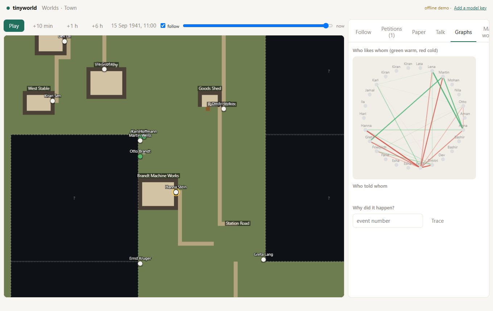

# TinyWorld v7: what was built

v6 made the builders visible. v7 makes the world feel alive: residents who live on their own clocks
in a place you can see, who walk into the unknown and make the map grow, and who come to you, the
god, with their problems. Every run is different. Every run is still recorded.

This page is [the v7 plan](V7_PLAN.md) as it was built: for each phase, what exists and where, the check that had to
pass, and what that check showed. Where a check needs a person, or a real model for longer than this
machine could give it, it says so.

**The one rule.** Behaviour is stochastic. Storage is a recording. Chance comes from the operating
system (`core/entropy.py`), and every draw is written to the branch journal when it is made, so a
replay reads the draws instead of making them. Two live runs differ; a replay of one is identical to
it. `tests/test_entropy.py` fails the build if world code reaches for `random` or `secrets` itself.

| Phase | What it is | State |
|---|---|---|
| 0 | Four experiments (petitions, chaos, newspaper, multiverse x5) | Run on the scripted stand-in; two need people ([V7_EXPERIMENTS.md](V7_EXPERIMENTS.md)) |
| 1 | Asynchronous residents, recorded randomness | **Done**; exit check passed |
| 2 | The tile world | **Done** |
| 3 | Lazy generation: the map grows | **Done** |
| 4 | Petitions: residents come to the god | **Done** on the stand-in; live check in the table below |
| 5 | Drives and stakes | **Done** on the stand-in; live check in the table below |
| 6 | Watchability | **Done**; "three papers" check needs a reader |
| 7 | Generations | **Done** |
| 8 | The multiverse | **Done** |
| 9 | Many gods | **Done** |
| 10 | Cost and scale | Estimate, budgets, per-resident models, batching **done**; Postgres **not done** |
| 11 | Evaluation for a world that never repeats | Metrics and judge gating **done**; judge calibration needs human labels |
| UI | The Town view | **Done** (canvas, not PixiJS) |

## Phase 1: asynchronous residents, recorded randomness

`sim/clock.py`. Each resident has a wake time. The world's clock moves to whoever wakes next, and
everyone due within a short window (2 simulated minutes) decides at once, each from the world as it was
when the window opened. Decisions are committed one at a time through the single writer; before each
commit the intent is checked against the world as it is *now*, and if the world moved under it the
person is told "that is no longer possible: ..." and decides again (optimistic concurrency). Something
addressed to a person, a loud event they can perceive, or a weighty memory wakes them early; a
promise's departure time caps any sleep.

What it took to make this hold up:

- **Replay** needed the order of each window and every committed decision journaled (`window`,
  `async_intents`, `clock`, `window_end`). A first replay failed on a batch of petitions because the
  Game Master's seeded shuffle differs between runs; petitions are now applied one at a time in a
  recorded order.
- **Pace.** A first run made 700 decisions per simulated hour for ten people, because a spoken line is
  two minutes long and woke the listener, who then spoke back. A minimum beat of ten minutes
  (a conversation already plays out inside one decision) and not waking people who were in the scene
  cut that tenfold. Copying the whole world on every commit was the next cost; rolling back by
  re-applying instead of copying per draft, a typed fast copy for state, and caching reply schemas
  made a simulated day several times cheaper.
- **Per-persona temperature** (0.6 to 1.0) is part of every model call (`LLMRequest.temperature`).
- **Perception noise.** What is heard or seen from afar is sometimes taken wrongly (a word lost or
  garbled; the detail after the first clause dropped). The slips are entropy draws, recorded, and a replay
  reads the same ones back (`Town(noise=True)`). *Not done:* distortion of a rumour as it is retold; that
  comes from the model's own retelling, which is recorded as the utterance.

**Exit check.** 48 simulated hours on the ten-person Berlin world, twice from the same start: the two
runs diverge (3% of events share words and place), and *both replay to an identical event log*. On
average 27% of residents act in a window (a tick makes 100% act together), and in 9% of windows more
than half do. About 3,000 decisions per run, 33 to 53 of them taken again after the world moved.

## Phase 2: the tile world

`world/grid.py`, `genesis/layout.py`, `world/walking.py`. State gains a chunked grid (32 by 32; one
character of terrain per tile) and *regions* (rectangles that belong to a place). New effects
`SetTiles` and `SetPosition`, with reducers and invariants: you can only stand on walkable ground that
belongs to a place, and a step is at most one leg of a walk. The layout turns a place graph into
buildings with walls, floors and a door facing the road, open places for squares and farms, rooms built
onto their building, roads door to door, a street block (a small place of its own) under every stretch
of road, and open ground under everything else. The place graph that routines use is *derived* from
where places touch, so `state.path` still works.

Movement is a walk in legs of up to five minutes; others can see the walker on the way, and doing
anything but walking ends the walk. Sight is a Bresenham line stopped by walls; speech carries a few
tiles and a shout further; each wall takes some of it. The scripted world and both fixtures lay out
with every place reachable and no overlaps, the same every time.

**Exit check.** Falkenrode and the Lucknow world are laid out on grids; residents walk real paths over
a long run with the invariants clean; two people in a street who see each other start talking
(`tests/test_grid.py`).

## Phase 3: lazy generation

`world/frontier.py`, `studio/creators.py`, `genesis/layout.extend`. Only generated chunks exist. When
someone walks to the edge, or sees across it, the ungenerated chunk is *requested*, once (a fact in the
log). The cartographer, scripted or a model, proposes two to four places with a few people each. The
proposal is checked (a place budget per chunk and a budget of new chunks for the run; no mention of
what the era lacks; plain names that are not taken) and then laid out, with placement drawn from
entropy and every effect run against a copy of the world so the reducers have the last word. What
passes is ordinary events, so **a replay never calls the creators**. New people arrive as background
folk and are promoted when events draw them in.

**Exit check.** Two runs of one world grow different maps beyond the starting district, and both keep
the invariants (`tests/test_growth.py`).

## Phase 4: petitions

`world/petitions.py`, `studio/desk.py`. A petition is an ordinary action that asserts an open fact;
on a tile map it is made at a shrine, temple, church or the podium (a world without one gets a
shrine), and others there see someone kneel while the words stay private. It opens a decision in the
studio queue with a card: who, faith, wants and fears, and the chain of events that led here. The god
answers with grant, whisper, a sign, refuse, punish or ignore; grant and punish take a sentence that
goes through the ordinary god channel. The answer becomes a memory and a belief, faith moves, and those
who saw a miracle take something from it. After 12 simulated hours nobody answering is itself the
answer: silence, which the petitioner remembers.

## Phase 5: drives and stakes

`world/drives.py`, `institutions.py`, `laws.py`, `economy.py`. Six drives per person with a set point
from their persona; frustration (how far the two worst are short) keeps a person off routine, shows in
their prompt, and raises their urge to ask the god. Events move drives by rule (money, a death, a
broken promise, a threat); levels drift back toward the set point. Every figure carries three *edges*
(a strong opinion, a grudge, a want that gets in someone else's way), and the critic blocks a cast
without them. Groups are founded, joined, split and dissolved by residents. A group with authority can
decree a ban, a curfew or a tax; a law touching an action hands it to the Game Master with the law in
the case. Prices follow scarcity once a day; loans are debts as relations. An undertaking can put up a
building, owned by whoever finished it; places can be sold.

## Phase 6: watchability

`sim/newspaper.py`, `sim/watch.py`. One edition a day, written from the log (by script, or by a model
that is checked: every story must cite events that exist that day), left at a busy place where people
read it and believe some of it. A follow-camera for any person, an interview in character that changes
nothing unless the god appears, graphs of who likes whom, who told whom, and why an event happened, and
a timeline that scrubs the map back through the day.

## Phase 7: generations

`world/lives.py`, `sim/years.py`, `world/cast.py`. Courtship, marriage, birth with inherited aptitudes
and traits, death by age or illness, inheritance of goods, property and debts. A skip of years runs a
season at a time, with one decision per year for each deciding adult. Causes link a child's first act
to a birth, the birth to a marriage, the marriage to the courting. People can be saved to a cast
library with their history and brought into another world.

**Exit check.** A 30-year skip gives a family tree three generations deep; a grandchild's choice traces
back through a marriage and a birth to a grandparent's courting in the cause graph
(`tests/test_lives.py`).

## Phase 8: the multiverse

`eval/multiverse.py`, "Many worlds" in the Town view. Fork a world N times, give each fresh entropy,
run them a few at a time, then see for every fact, person and place in how many runs it held. Any run
can be opened as the main line. 20 runs of one premise produce a spread in which a death, a marriage
or a birth happens in some runs and not in others (`tests/test_multiverse.py`).

## Phase 9: many gods

`world/gods.py`. Roles (god, demigod with a daily budget of points, observer), and an AI god with a goal
of its own ("make the mill fail") that uses the same powers. When two gods' acts in one window touch the
same thing, the higher role prevails and equals are settled by a recorded draw; the loser is refused and
the world is told: a public fact says the gods disagree, and residents remember it.

## Phase 10: cost and scale

`sim/cost.py`, `llm/mixed.py`. An estimate before a run: probe a fork for a simulated day with the same
engine, count calls and tokens by role, scale to the people and days asked for, price them. Budgets per
run and per simulated day: over 70% the town's pauses lengthen, over 85% everyone drops to the cheap
tier, at the cap it stops asking the model anything. A resident can have a model of their own
(`LLMConfig.agent_models`) with a client per model behind one (`MixedClient`), so most can run on a
local open-weight model and a few on a hosted one. Witnesses' memories are written once per window, not
once per commit.

**Not done: Postgres.** The queue and workers from v6.6 run one build per worker on SQLite. Moving the
event log to Postgres for many worlds at once is a change of driver and a lot of care, and has not been
made.

## Phase 11: evaluation

`eval/v7_metrics.py`. Liveliness (events per resident per day that are not routine), disagreement (the
share of conversations with a refusal, an argument or a threat), coherence (invariant violations, what
the era lacks), readability (how much of the day's weightiest events the paper covers, and whether it
invents any), cost per resident per day, petition quality. A judge must be from a different model family
than the residents and is trusted only after it agrees with human labels (n of at least 20 and Cohen's
kappa of at least 0.6). The labels themselves have not been made.

## The Town view

`api/town_routes.py`, `api/static/app/js/town.js`. A canvas map with chunks streamed in as the map grows,
fog over what is not yet made, people with name plates and state colours, day and night, a follow
camera, a timeline scrubber, and panels for following a person, petitions (the podium), the paper,
talking to a resident, graphs, and many worlds. The wire protocol gains `chunk.upsert`, `position`
(batched), `petition` and `edition.add`. It is Canvas 2D rather than PixiJS: the map is a few thousand
tiles, and it needs no library or network.

